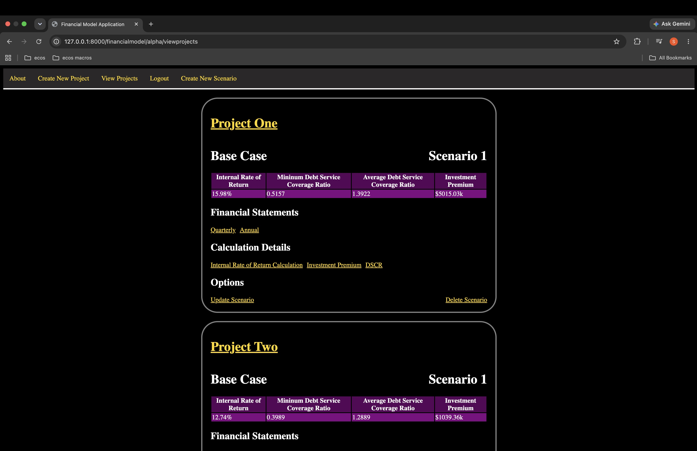
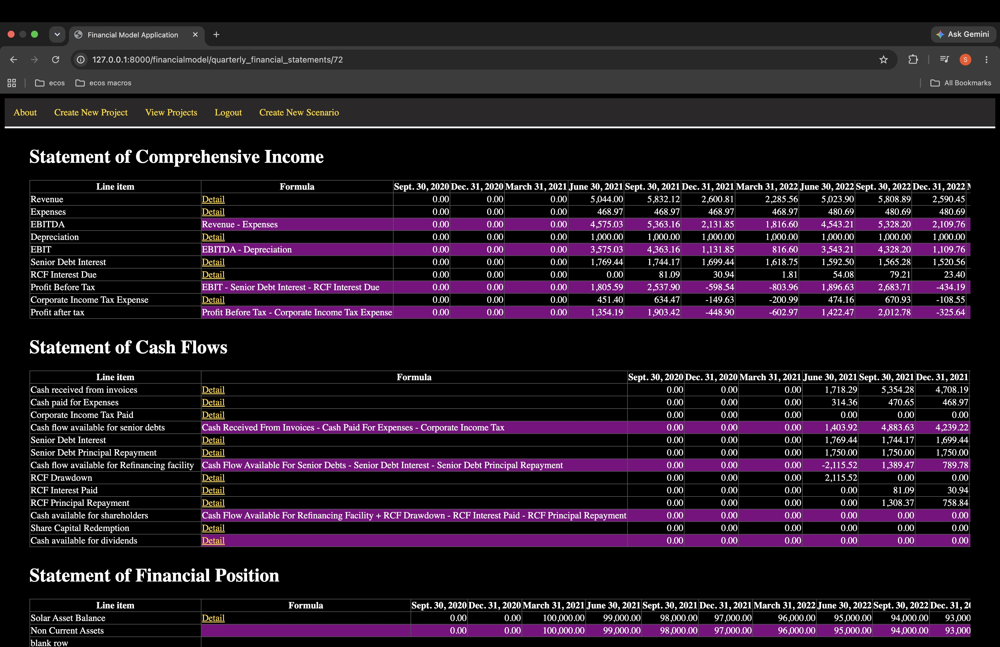
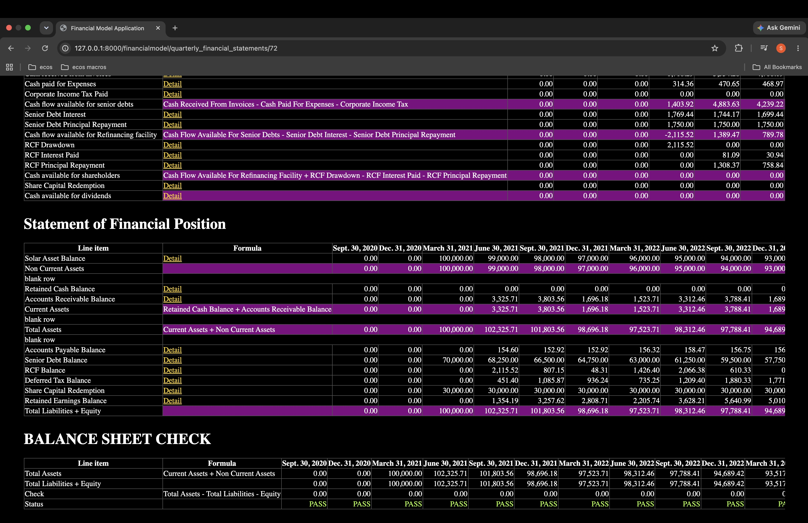
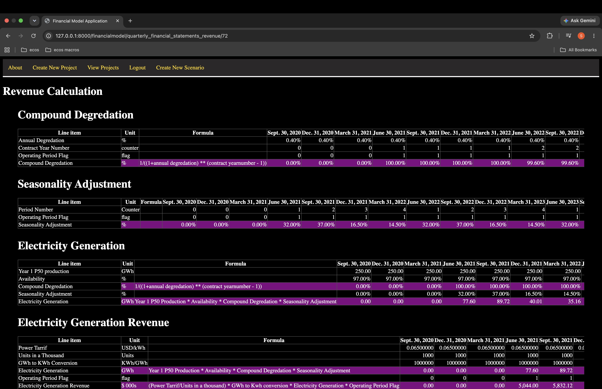
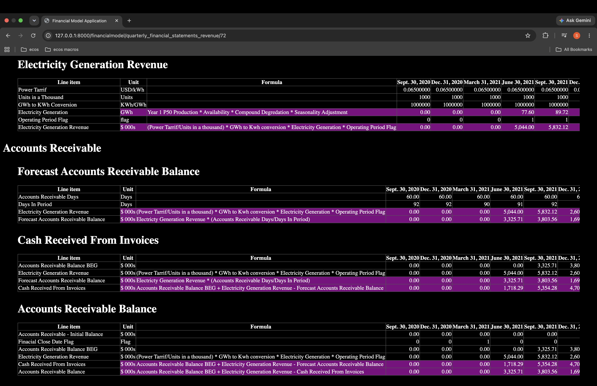
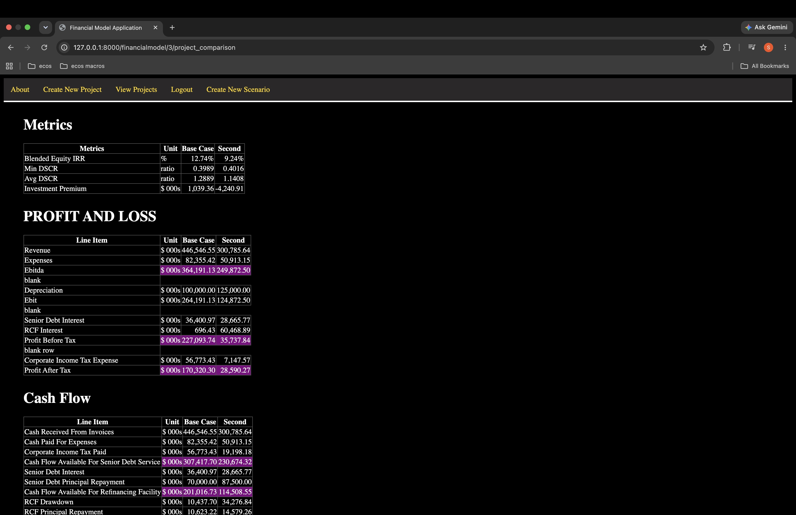
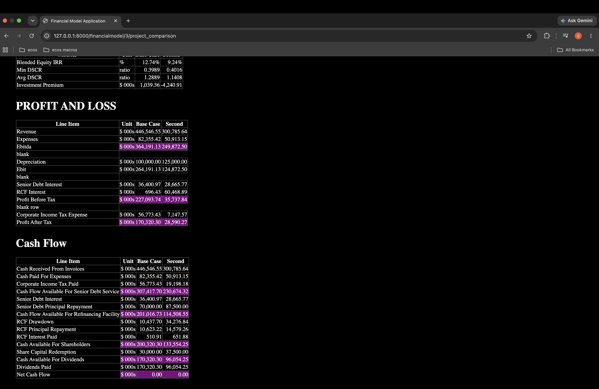

Financial Modelling App By Philip

# Overview

This is a financial modelling web application inspired by Gridlines Essential Financial Modelling and its financial model template. This version one demo is for the scenario in which an investment opportunity into a solar project is being evaluated. With the use of the required financial inputs from the user, this model generates quarterly and annual financial statements, with the metrics produced being the investment premium, the internal rate of return, the minimum debt service coverage ratio and the average debt service coverage ratio, metrics used to evaluate this investment

## Assumptions

### Overall Assumptions
- That this is a construction of a financial model to evaluate an investment opportunity of a solar project
- That the length of an operating period is 3 months, thus creating quarterly financial statements

### Electricity Generation Assumptions
- That with the electricity generation, that there is a maximum availability of GWh per year
- That the solar plant will operate at a percentage of power production and the generation will be subjected to a percentage performance degradation per annum
- That 100% of the annual prodcution will be split up into 4 quarters
- That theres an unindexed power tariff at cents/KWh
- That electiricty generation is subjected to a percentage performance degradation per annum
### Expense Assumptions
- That there is a fixed annual fee that is agreed on
- The fixed annual fee is indexed to a CPI
- That indexation is applied annually on the anniversary of the beginning of the project
### Debt Assumptions
- Interest and principal on the senior loan will be paid quarterly
### Revolving Credit Facility
- The facility ranks below senior but above any shareholder distributions in the cash flow waterfall


## Features

- User registration, login and logout
- Create Projects
- Create, edit and delete scenarios
- Quarterly and Annual Financial Statement Generation
- Financial Calculation Detail Pages 
- Scenario Comparison
- XIRR
- Investment Premium calculation
- Balance sheet validation


## Screenshots

### View Projects Page


### Quarterly Financial Statements Page




### Revenue Calculation Detail Page




### Scenario Comparison Page




## Tech Stack

- Python
- Django
- HTML
- CSS

## Web Pages

### About Page
This is the index page, displaying what the website is about

### Create New Project Page
This page contains the create a new project form, with the required information being the Project Name

### View Projects Page
This page contains the list of all the created scenarios summarised. The following information is displayed for each scenario:
- The Project Name the scenario belongs to. This is also a link to scenario comparison page, which compares all the scenarios belonging to that project 
- The scenario name
- The scenario number
- The scenario Internal rate of return
- The scenario Minimum Debt Service Coverage Ratio
- The scenario Average Debt Service Coverage Ratio
- The scenario Investment Premium 
- A link to the scenario Quarterly Financial Statements 
- A link to the scenario Annual Financial Statements 
- A link to the Internal Rate of Return Calculation 
- A link to the Investment Premium Calculation
- A link to the Debt Service Coverage Ratio
- A link to update the scenario
- A link to delete the scenario

### Scenario Comparison Page
This page contains the all of the relevant scenarios relating to the project and compares the following of each scenario:
- The Internal Rate of Return 
- The minimum Debt Service Coverage Ratio
- The Average Debt Service Coverage Ratio
- The Investment Premium
- Statement of Profit and Loss
- Statement of Cash Flow


### Quarterly Financial Statements Page
This page contains the generated Quarterly Financial Statements of the relevant scenario, including the Statement of Comprehensive Income, the Statement of Cash Flows and the Statement of Financial Position. This page also contains a balance sheet check, in which the calculation of Total Assets - (Total Liabilities + Equity) as assessed for each quarter to determin if this is equal to 0.00 . For calculations of each Financial Statement line items which are not shown in the financial statements, these contain a link via Detail in the Formula column, which takes the user to the detailed calculation page, which shows in detail how the financial statement line item is calculated. 


### Annual Financial Statements Page
This page contains the generated Annual Financial Statements of the relevant scenario, including the Statement of Comprehensive Income, the Statement of Cash Flows and the Statement of Financial Position. This page also contains a balance sheet check, in which the calculation of Total Assets - (Total Liabilities + Equity) as assessed for each year end to determin if this is equal to 0.00 . For calculations of each Financial Statement line items which are not shown in the financial statements, these contain a link via Detail in the Formula column, which takes the user to the detailed calculation page, which shows in detail how the financial statement line item is calculated. 

### Internal Rate of Return Calculation Page
This page contains the details of how the Internal Rate of Return is calculated 

### Investment Premium Page
This page contains the details of how the Investment Premium is calculated 

### DSCR Page
This page contains the details of how the Debt Service Coverage Ratio is calculated 

### Update Scenario Page
This page contains the form needed to update the inputs of the scenario 
- Scenario Name
- Scenario Number
- Timelines
- First Date of Time Rulers
- End of First Operating Period
- Acquisition Date
- Length of Contract
- Q1 Seasonal Adjustment '%' of annual yield
- Q2 Seasonal Adjustment '%' of annual yield
- Q3 Seasonal Adjustment '%' of annual yield
- Q4 Seasonal Adjustment '%' of annual yield
- Annual Degredation
- Year 1 p50 Production
- Availability
- Power Tariff
- OPEX
- Annual Real O&M Cost
- Expected CPI at close
- CPI at O&M contract signature date
- Forecast CPI Growth Rate %
- Senior Debt
- Senior Debt Gearing %
- Senior Debt Day Count Convention days
- Senior Debt Swap Rate %
- Senior Interest Margin %
- Repayment Term years
- Revolving Credit Facility
- Interest Rate %
- Initial Balance
- Equity
- Share of Project %
- Target IRR %
- Working Capital
- Accounts Receivable Days
- Accounts Payable Days
- Depreciation
- Useful Life Of Solar Asset
- Solar Asset Book Value
- Retained Cash - Initial Balance
- Accounts Receivable - Initial Balance
- Accounts Payable - Initial Balance
- Retained earnings - Initial Balance
- Deferred Tax - Initial Balance
- Corporate Income Tax Rate
- Tax Depreciation Rate %
- Tax Losses Carried Forward - Initial Balance

### Create New Scenario Page
This page contains the form needed to create a new scenario. The required information includes
- Scenario Name
- Scenario Number
- Timelines
- First Date of Time Rulers
- End of First Operating Period
- Acquisition Date
- Length of Contract
- Q1 Seasonal Adjustment '%' of annual yield
- Q2 Seasonal Adjustment '%' of annual yield
- Q3 Seasonal Adjustment '%' of annual yield
- Q4 Seasonal Adjustment '%' of annual yield
- Annual Degredation
- Year 1 p50 Production
- Availability
- Power Tariff
- OPEX
- Annual Real O&M Cost
- Expected CPI at close
- CPI at O&M contract signature date
- Forecast CPI Growth Rate %
- Senior Debt
- Senior Debt Gearing %
- Senior Debt Day Count Convention days
- Senior Debt Swap Rate %
- Senior Interest Margin %
- Repayment Term years
- Revolving Credit Facility
- Interest Rate %
- Initial Balance
- Equity
- Share of Project %
- Target IRR %
- Working Capital
- Accounts Receivable Days
- Accounts Payable Days
- Depreciation
- Useful Life Of Solar Asset
- Solar Asset Book Value
- Retained Cash - Initial Balance
- Accounts Receivable - Initial Balance
- Accounts Payable - Initial Balance
- Retained earnings - Initial Balance
- Deferred Tax - Initial Balance
- Corporate Income Tax Rate
- Tax Depreciation Rate %
- Tax Losses Carried Forward - Initial Balance


# What I Learned 

Building this application allowed me to strengthen my understanding of Django, Python and web development while applying my financial accounting knowledge to a software engineering project.

1. Working with Dates and Timelines

This was my first experience working extensively with Python's datetime library

I learned how to work with dates and construct a financial model timeline consisting of quarterly operating periods. I also gained experience using dates to determine when specific financial calculations should occur, such as commencement of operations, debt repayments, depreciation and the end of the project. 

2. Financial Calculations and Dependencies

One of my biggest challenges was translating the calculations from an Excel-based financial model into Python. 

I learned how to structure calculations so that the output of one calculation could be used as an input for another. An example being how electricity geneation determines revenue, then revenue and operating expenses determine EBITDA, and cash-flow calculations determine the amounts available for debt servicing and shareholder distributions. 

This helped me better understand how to organise interdependent calculations within an application. 

3. Database Precision and Financial Calculations 

An important lesson was understanding the impact of numerical precision when storing financial calculations in a database. 

During development, I encountered an issue where the balance sheet did not balance exactly, despite the underlying calculations appearing correct. 

After investigating, I discovered that some calculated values were being rounded to two decimal places when stored in the database. This caused small rounding differences to accumulate throughout the financial model. 

I resolved this by increasing the precision of the relevant Django model fields and separating the precision used for calculations from the formatting used to display results. 

This taught me the importance of retaining sufficient precision throughout financial calculations and only rounding values for presentation. 

4. Calculating IRR Using Dates

I gained a better understanding of the difference between IRR and XIRR

Initially, I used a conventional IRR calculation based on equally spaced quarterly cash flows. However, I learned that XIRR uses the actual dates of cash flows, making it more appropriate for reconciling the results to the Excel Financial Model. 

I subsequently incorporated XIRR calculations into the application 

5. Debugging and Validating Calculations 

A valuable part of the project was learning how to investigate differences between the application and the reference Excel model. 

Rather than focusing only on the final financial metrics, I compared the underlying calculation schedules, incuding revenue, operating expenses, depreciation, debt, taxation and cash flows. 

This helped me develop a more systematic approach to debugging, identifying the source of differences and validating that changes produced the expected results


# Testing and Validation

## Manual Testing

Manual tests were carried out on the application with the areas covered being:

- Project creation
- Scenario creation, updating and deletion
- Input validation and project timeline calculations
- Revenue, operating expenses, depreciation and working capital 
- Senior debt, revolving credit facility, taxation and equity
- Quarterly and annual financial statement generation
- IRR, DSCR and investment premium calculations 
- Balance sheet reconciliation
- Scenario comparison and isolation
- Numberical precision and financial statement formatting
- Navigation, responsiveness and data persistence
- Edge cases and end-to-end application functionality

## Financial Model Reconciliation

A comparison between the application's financial calculation and the reference Gridlines Excel financial model took place. 

The reconciliation included underlying included underlying financial schedules, quarterly and annual financial statements, cash-flow calculations and investment metrics. 

Balance-sheet checks were also done to ensure that the total assets was equall to the total liabilities and equity throughout the model. 


# Installation and Setup

## Requirements

- Python 3
- Git
- pip

## Installation. 

1. clone the repository:

```
git clone https://github.com/pmusoke/REPOSITORY.git
cd REPOSITORY
```

2. Create a Python virtual environment:

```
python3 -m venv .venv
```

3. Activate the virtual environment.


On MacOS/Linux:
```
source .venv/bin/activate
```

On Windows PowerShell:
```
.venv\Scripts\Activate.ps1
```

4. Instrall the needed dependencies

```
python -m pip install -r requirements.txt
```

5. Configure required environment variables described in the project configuration

6. Apply Django database migrations:

```
python manage.py migrate
```

7. Start the Django development server:

```
python manage.py runserver
```

8. Open the application in your local browser:

http://127.0.0.1:8000/financialmodel/

## Using the Application

Once the application is up and running, the user can register an account and then log in

The user can create a project, add financial scenarios, enter the required assumptions and view the financial statements and investment metrics which have been generated. 

Please note that this application is a local development/demo project and has not been configured for production deployment. 